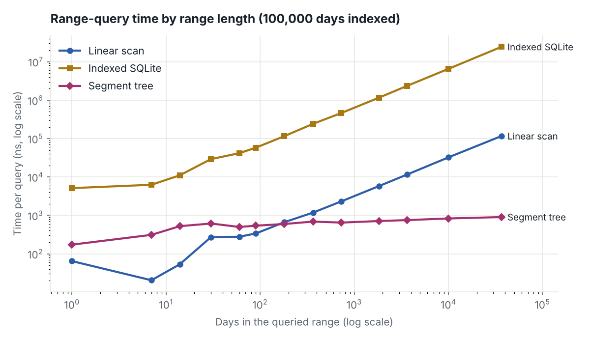
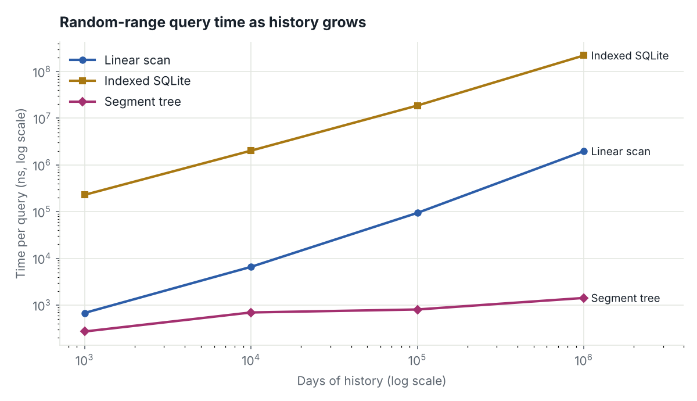

# Benchmark: segment tree vs linear scan vs indexed SQLite

**Result:** for long date ranges the segment tree is faster by orders of magnitude, and its query time barely grows with history (about 0.2 to 1.4 µs from 1,000 to 1,000,000 days). For short ranges, up to about 6 months, a plain scan of a contiguous array is faster. SQLite was the slowest of the three at every range length and size measured.

Measured 2026-11-13 on a shared cloud VM (Intel Xeon @ 2.10 GHz, 2 cores, Release build, g++ 13). Re-run it on the Raspberry Pi 5 for the report; absolute times will differ, the shape should not. Raw output: [`bench/results-x86-container.txt`](../bench/results-x86-container.txt), CSV: [`bench/results-x86-container.csv`](../bench/results-x86-container.csv).

## What is compared

Each query returns, over days `[l, r]`, the count of logged days and the sum, min and max of all 9 tracked nutrients (27 aggregates).

| Method | How it answers | Cost per query |
| --- | --- | --- |
| Linear scan | Loops over `[l, r]` in a contiguous array of daily totals | O(range length) |
| Indexed SQLite | `SELECT COUNT(*), TOTAL(..), MIN(..), MAX(..) FROM daily WHERE day BETWEEN ? AND ?` on an in-memory table with `day` as the primary key | O(log n + range length) |
| Segment tree | `SegmentTree::query(l, r)` | O(k log n) |

Data is synthetic: about 90% of days logged, calories drawn from a normal distribution around 2,200. Every tree and SQLite answer in a 200-query sample per test is checked against the linear scan; all runs reported 0 mismatches. Each time is the median of 5 timed passes.

## Query time by range length



At 100,000 days indexed:

| Range length (days) | Linear scan | Segment tree | Faster |
| ---: | ---: | ---: | --- |
| 7 | 20 ns | 311 ns | Scan, 16× |
| 30 | 271 ns | 614 ns | Scan, 2.3× |
| 90 | 338 ns | 539 ns | Scan, 1.6× |
| 180 | 662 ns | 596 ns | Tree, 1.1× |
| 365 | 1.2 µs | 690 ns | Tree, 1.7× |
| 1,825 (5 years) | 5.8 µs | 712 ns | Tree, 8× |
| 36,500 (100 years) | 116 µs | 903 ns | Tree, 128× |

The crossover is at roughly 180 days on this machine.

## Query time as history grows



Random ranges (both ends uniform, so the mean length is a third of the history):

| Days of history | Linear scan | Indexed SQLite | Segment tree | Tree build | Tree memory |
| ---: | ---: | ---: | ---: | ---: | ---: |
| 1,000 | 677 ns | 229 µs | 271 ns | 0.3 ms | 0.4 MB |
| 10,000 | 6.6 µs | 2.0 ms | 694 ns | 4.1 ms | 6.9 MB |
| 100,000 | 94 µs | 18.7 ms | 804 ns | 41 ms | 55 MB |
| 1,000,000 | 1.97 ms | 221 ms | 1.4 µs | 421 ms | 440 MB |

Point updates (editing one day's totals): segment tree 143 ns to 1.0 µs, SQLite `INSERT OR REPLACE` 1.2 to 2.4 µs. The array updates in O(1).

## Honest caveats

- **Realistic sizes are small.** Ten years of logging is about 3,650 days. At that size every method answers in well under a millisecond, so a single user would not notice the difference. The tree's advantage is asymptotic; the 100,000 and 1,000,000-day runs exist to show the growth rates, not a real workload.
- **Short windows favor the scan.** The most common chart request (the last 7 or 30 days) is faster with a scan, because 30 contiguous rows fit in cache and the tree pays for about 2 log n node visits. The tree wins for month, year and all-time summaries, rolling averages over long histories, and best/worst-day lookups.
- **SQLite is doing generic work.** It computes 27 aggregate functions through its bytecode engine row by row. Asking for fewer columns would make it faster, but its cost still grows with range length. It remains the right place to *store* data; the tree is an index on top of it.
- **Memory is the tree's cost.** Each node holds 3 doubles per nutrient plus a count, about 220 bytes with 9 nutrients, and the tree has about 2n nodes (n rounded up to a power of two). That is 440 MB at 1,000,000 days, but under 1 MB for any realistic history.
- **Shared-VM noise.** Single points can jump about 2× between runs on this machine. The median of 5 passes removed the outliers seen with 1 pass.

## Reproduce

```bash
cmake -S . -B build-release -DCMAKE_BUILD_TYPE=Release
cmake --build build-release --target benchmark -j
./build-release/benchmark --repeats 5 --budget-ms 3000 --csv bench/results-pi5.csv | tee bench/results-pi5.txt
python3 bench/plot.py bench/results-pi5.csv docs/
```

On a Pi with less than 2 GB of RAM, drop the largest size: `--sizes 1000,10000,100000`.
